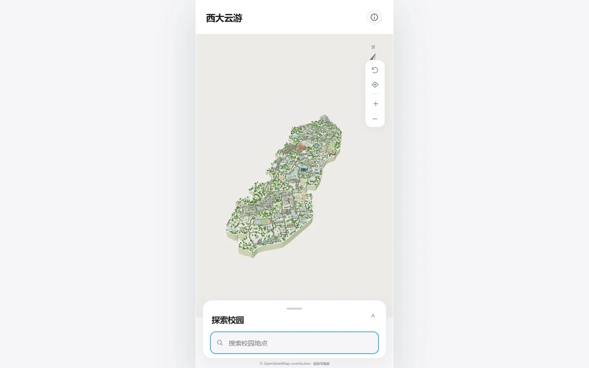
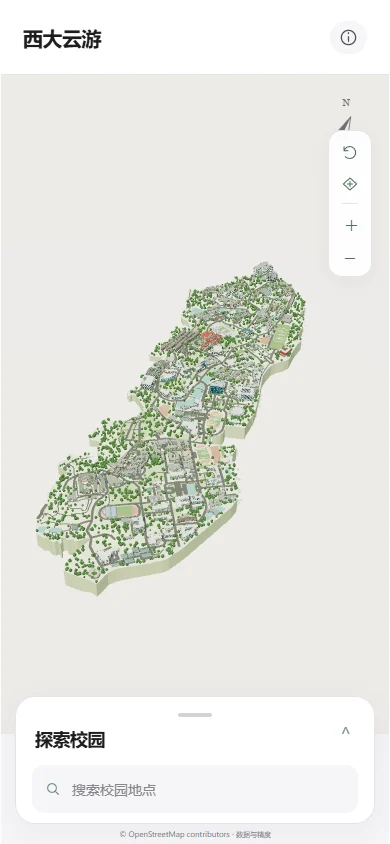

# 西大云游

西南大学北碚校区的交互式三维校园地图，使用 Three.js 展示建筑、道路、水域与地形，支持手机和电脑访问。

当前统一使用手机竖屏布局，电脑预览按9∶16比例居中显示，最大宽度430像素，窗口较小时等比缩小。



## 可以做什么

- 探索 300 个建筑对象、299 条道路分段和 93 个水体、绿地及运动场要素。
- 搜索楼名、旧名和宿舍舍号，查看建筑资料、来源与单栋模型。
- 旋转、缩放、俯视，切换日间、黄昏与夜景，自动漫游校园。
- 切换图层，分享地点链接，导出带署名的校园图片。

当前提供地图展示，讨论显示“暂不开放”。



## 本地运行

需要 Node.js 24、npm 和支持 WebGL 的浏览器。

```bash
git clone https://github.com/moonpleasee/swu_3dmap.git
cd swu_3dmap
npm ci
npm run build
npm run preview
```

打开终端显示的地址，默认是 `http://127.0.0.1:4310/`。Windows PowerShell 可使用 `npm.cmd`。

修改前端时运行 `npm run dev`。需要本地完整服务时运行 `npm start`，默认地址为 `http://127.0.0.1:4311/`，配置示例见 `.env.example`，社区功能默认关闭。

## 部署与开发

`npm run build` 会生成 `dist/`，将其中全部文件发布到静态托管空间即可。使用子目录时，入口地址应保留末尾的 `/`。部署说明见 [docs/DEPLOYMENT.md](docs/DEPLOYMENT.md)。

| 目录 | 内容 |
| --- | --- |
| `src/` | 地图、模型与界面代码 |
| `public/` | 运行数据及静态资源 |
| `data-sources/` | 来源数据、建筑配置与逐栋清单 |
| `scripts/` | 构建和检查工具 |
| `server/` | 本地服务及后续社区功能代码 |
| `docs/` | 维护、来源、验证与历史记录 |

修改后执行 `npm run build`，按改动运行相关检查，并实际查看页面。参与方式见 [贡献说明](.github/CONTRIBUTING.md)。

## 模型与资料

目前 63 个建筑有单体照片参考，53 个采用园区同组参考，其余 184 个为按轮廓和用途配置的估算外观。地形基于约 30 米级公开 DEM。楼名、层高、入口和局部地形仍有待核实内容。

来源见 [docs/SOURCES.md](docs/SOURCES.md)，逐栋记录在 [data-sources/registers/](data-sources/registers/)。欢迎提供能对应具体楼栋的照片与资料。

## 反馈与授权

问题、建议、建筑纠错和商业授权咨询都可以通过 [GitHub Issues](https://github.com/moonpleasee/swu_3dmap/issues/new) 联系维护者 moonpleasee。

自有代码采用 [PolyForm Noncommercial 1.0.0](LICENSE)。**超出该许可证许可范围的商用，需联系维护者取得另行书面授权。** OSM 数据及第三方组件按各自许可证提供，详见 [NOTICE.md](NOTICE.md)。

本项目采用公开源码、非商用授权方式，为个人作品，与西南大学官方无关。

维护与公开准备情况集中在 [docs/MAINTENANCE.md](docs/MAINTENANCE.md)，开发接续见 [HANDOFF.md](HANDOFF.md)。
